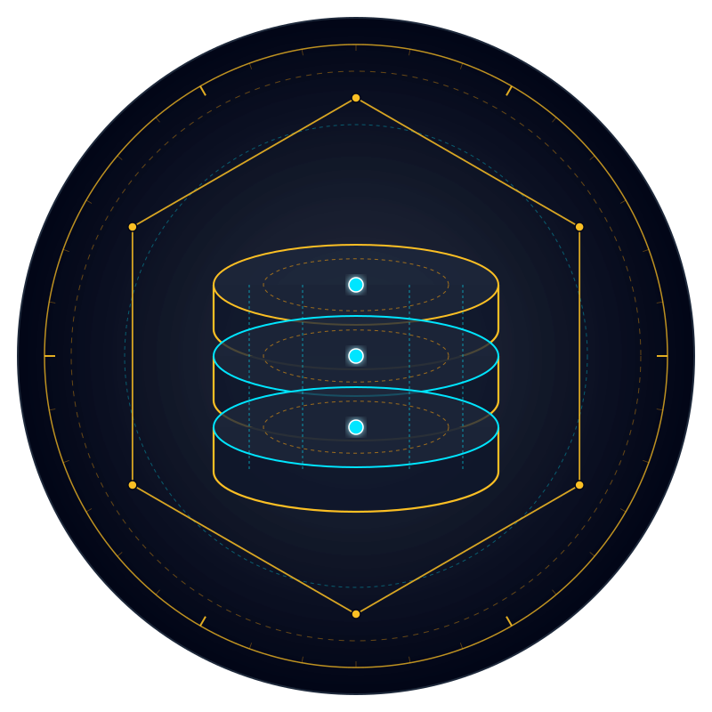

# 🏛️ SovereignDB (`sovereign-db-dist`) — Official Distribution & Verification Hub

> **High-Speed Bare-Metal NVMe SQLite WAL Engine, Hybrid Logical Clocks & Merkle-DAG Replication**  
> *Zero cloud dependencies • Pure safe Rust • Musl static standalone binary • 100% Adversarial TDD Tested*

[](https://github.com/rmediatech/sovereign-db-dist/releases/tag/v0.2.0)
[](https://rmediatech.com/downloads)
[-brightgreen.svg)](#)
[-blue.svg)](#)
[](#)
[-blueviolet.svg)](SOVEREIGN_RELEASE_KEY.asc)
[](https://rmediatech.com)
[](LICENSE)

<p align="center">
  
</p>

---

## 🏛️ Overview

**SovereignDB** is an enterprise-grade, zero-cloud bare-metal persistence and replication engine engineered in 100% safe Rust. Designed to liberate developers from managed cloud database feudalism (Supabase, AWS RDS, Neon) and egress tolls, SovereignDB operates directly on dedicated NVMe storage with microsecond query evaluation and mathematical anti-double-spend guarantees.

### Core Capabilities
* **$0/Month Zero-SaaS Bare-Metal Engine**: Operates directly on local NVMe SSDs with 256MB direct memory mapping (`PRAGMA mmap_size = 256MB`), eliminating remote network hops and subscription taxes.
* **Mathematical Anti-Double-Spend Concurrency**: Enforces atomic conditional updates (`UPDATE ... WHERE balance >= :cost`), eliminating race condition double-spending under concurrent multi-node workloads.
* **Hybrid Logical Clocks (HLC) & Merkle-DAG Replication**: Combines monotonic physical time with Lamport logical counters and Merkle-DAG WAL delta streaming for convergent multi-node replica synchronization.
* **Cryptographic Merkle Provenance**: State transitions emit structured 5W1H micro-provenance records anchored directly to cryptographic hash chains via `sovereign-ledger`.
* **Single Standalone Static Binary**: Statically linked against Musl libc, self-contained, with $<20\text{MB}$ memory footprint.

---

## 📦 Binary Verification & Download

Verified standalone binaries are distributed directly through the **[RMediaTech Sovereign Binary Vault](https://rmediatech.com/downloads)**:

| Platform | Architecture | Checksum (SHA-256) | Vault Download |
| :--- | :--- | :--- | :--- |
| **Linux (Static Musl)** | `x86_64` | `e1eb83072fb7b3f813d4d67535e17f4d38190ef5540a17a7317150dbf27ec637` | [Download (8.8 MB)](https://rmediatech.com/bin/sovereign-db) |

### 1-Click Stream Download & Installation
```bash
# 1-Click Stream Install
curl -sSL https://rmediatech.com/install/sovereign-db | sh

# Or Direct Binary Download
curl -sSL https://rmediatech.com/bin/sovereign-db -o sovereign-db
chmod +x sovereign-db
```

### Cryptographic Provenance Verification (`SOVEREIGN-SIGN-01`)
All releases are cryptographically sealed by `Rick Walker (Sovereign Release Signing Key) <rick@rmediatech.com>` (Key ID: `4E428019A109578B`):

```bash
# Import Public Key
curl -sSL https://rmediatech.com/SOVEREIGN_RELEASE_KEY.asc | gpg --import

# Verify Detached OpenPGP Signature
curl -sSL https://rmediatech.com/signatures/sovereign-db -o sovereign-db.asc
gpg --verify sovereign-db.asc sovereign-db
```

---

## 🚀 Quickstart

```bash
# Start sovereign database engine with local WAL database
sovereign-db --db /var/lib/sovereign-db/data.db

# Perform hot online backup and WAL checkpoint truncation
sovereign-db checkpoint --truncate

# Inspect replication status and HLC vector clocks
sovereign-db replication status
```

---

## 🛡️ License & Provenance

Dual-licensed under MIT OR Apache-2.0. Cryptographically sealed by Rick Walker (`4E428019A109578B`).
